# goaduc

A web UI for running a Samba 4 Active Directory domain. It covers the things you'd normally reach for ADUC,
Sites and Services, the DNS console and GPMC to do, but you open it in a browser and it runs on Linux.

It's one static Go binary built on nothing but the standard library. That includes the LDAPv3 client, which I wrote
by hand so there'd be no third-party modules and no cgo to worry about.

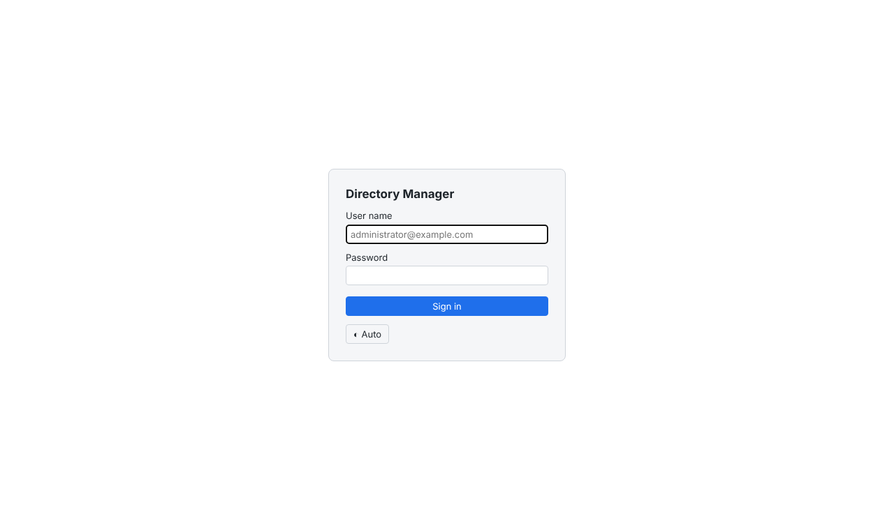

## A quick tour

Everything below is from the built-in mock directory (more on that at the bottom), so the names are made up.

### Users and Computers

This is the page you'll probably live in. Browse the OU tree, create, delete, move and rename users, groups, OUs and
computers, reset passwords, enable, disable or unlock accounts, edit group membership, and search. You can also type
a raw LDAP filter if you'd rather. Double-click anything to open its properties.

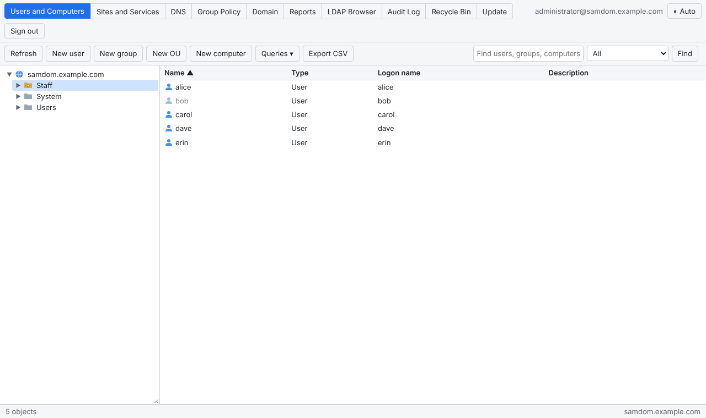

The properties dialog has the usual tabs: logon hours, account expiry, log-on-to, profile, telephones, address,
organization and manager, SPNs and delegation, managed-by. The Attributes tab edits any attribute directly.
There are also saved queries with a query builder, and *Export CSV* on the user list.

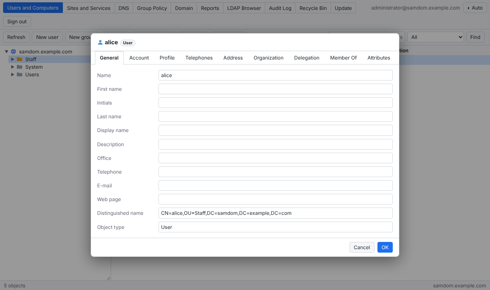

Next to the domain's own containers in the tree are the other naming contexts: Configuration (with Schema inside it)
and the DNS partitions. That's the ADSI Edit-style view, for the things nothing else in goaduc has a page for. Objects there show their raw LDAP class
instead of a friendly type, open the same properties dialog (with the Attributes tab), and can be renamed or deleted
from the right-click menu. Typing an LDAP filter in the find box searches below whatever you have selected, and
*Queries ▾ → Schema search* looks up schema classes and attributes by name, using whatever you typed in the find box.

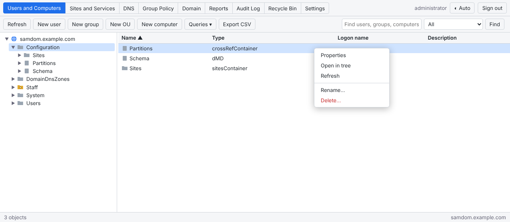

### Sites and Services

Works on `CN=Sites,CN=Configuration,...`. You can create sites (with their Servers and NTDS Site Settings children,
and optionally join them to a site link), add subnets (CIDR is validated) and assign them to a site, manage IP site
links (cost, interval, change notification, member sites), move servers between sites, set the Global Catalog flag on
NTDS Settings, and add manual replication connections. The built-in containers (Sites, Subnets, Inter-Site Transports,
IP, SMTP) are protected from rename, move and delete.

You *can* delete servers and NTDS objects, but I'd advise against it. Retire a DC with `samba-tool domain demote`
instead. Also keep in mind that the KCC owns its auto-generated connections.

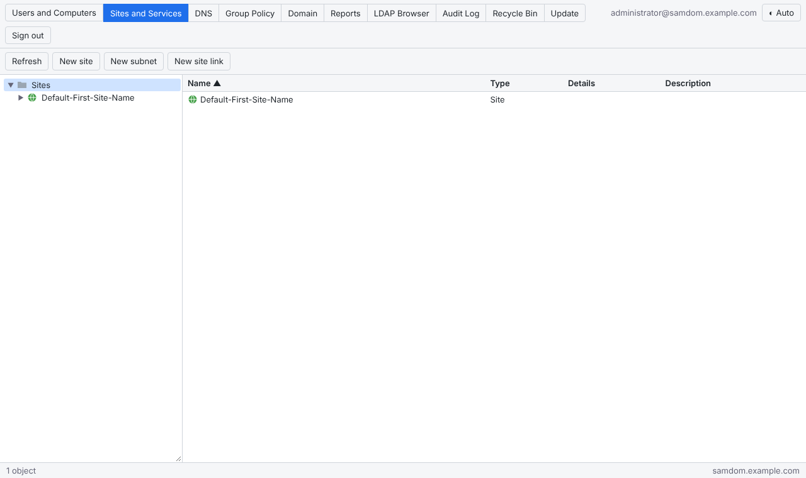

### DNS

Browse zones and add, edit or delete A, AAAA, CNAME, MX, NS, PTR, SRV, TXT and SOA records. Records are read and
written straight in LDAP (the binary `dnsRecord` attribute, MS-DNSP layout), and the SOA serial goes up on every
change. Creating and deleting whole zones isn't supported, so use `samba-tool dns zonecreate` for that.

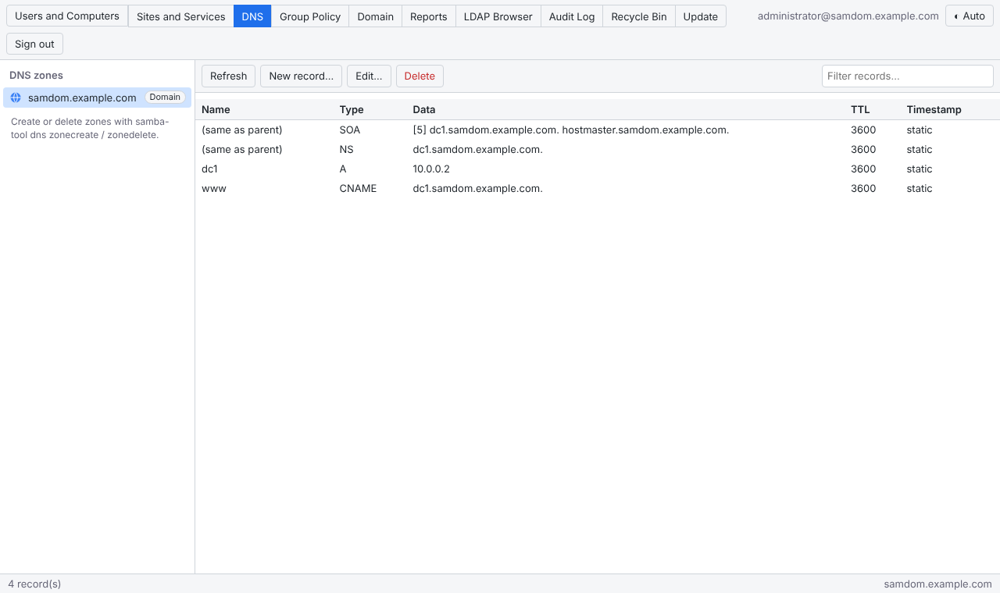

Right-clicking works here, and on the Group Policy and Recycle Bin pages too.

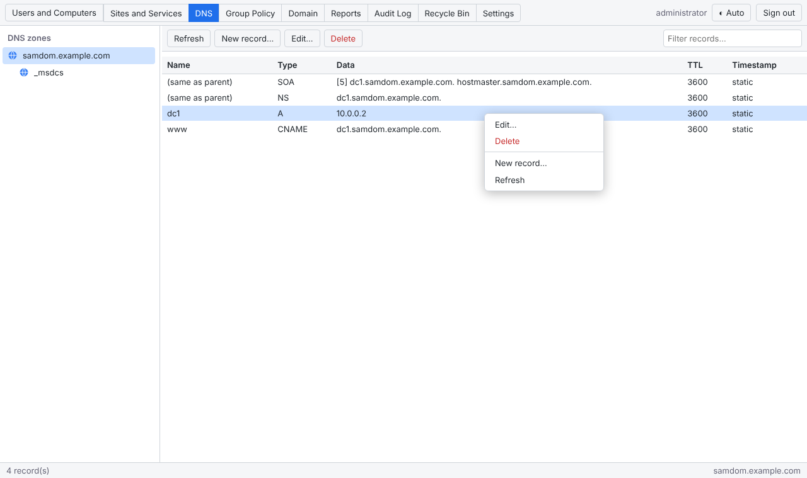

### Group Policy

A GPMC-style page, split into two halves:

* **GPOs and links** live in LDAP and are changed as the signed-in user. You can list, create, rename and delete
  GPOs, switch the computer or user half on and off, and link a GPO to the domain, an OU or a site (enforced, link
  enabled, link order, block inheritance).
* **Settings** are files in SYSVOL. The **Computer** and **User** tabs edit `Registry.pol` (key, value, type, data,
  plus "delete value" entries). **Security** edits `GptTmpl.inf` (password and lockout policy, user rights,
  restricted groups, audit, registry values). **Files** browses the GPO folder (scripts, preferences XML and so on)
  with view, edit, upload, download and delete. **Details** shows versions and the client-side-extension lists.

Every change bumps the GPO version in AD and in `GPT.INI` and registers the extension, so clients pick it up.
There's no ADMX template UI. Administrative Templates are edited as raw registry entries.

This part **needs goaduc running on the domain controller as root**, because it writes SYSVOL (`-sysvol`, default
`/var/lib/samba/sysvol`). It only tries a SYSVOL write after the signed-in user's own LDAP modify of the GPO has
succeeded, so AD permissions still decide who gets to edit. Files goaduc writes get ordinary POSIX permissions
(0644/0755) and no NT ACL. If your clients or `samba-tool ntacl sysvolcheck` complain, run
`samba-tool ntacl sysvolreset`.

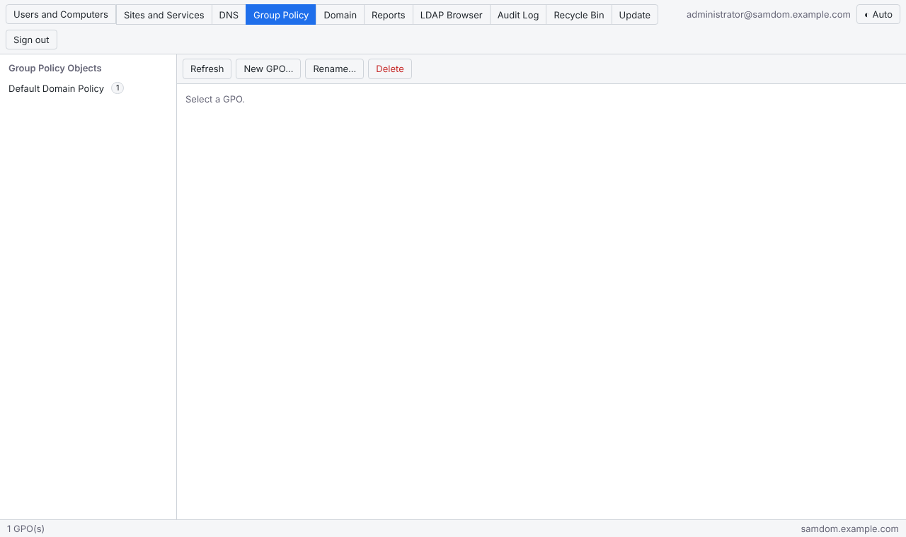

### Domain

Functional levels, FSMO role holders and DCs (read-only), the default domain password and lockout policy, and
fine-grained password policies (create, edit, delete, apply to users or groups).

This is also where you manage **alternative UPN suffixes**, the same list Windows keeps under *Active Directory
Domains and Trusts → Properties*. Right-click in the card for *Add…*, or right-click a suffix for *Add…* or *Delete…*.
It's the `uPNSuffixes` attribute on `CN=Partitions,CN=Configuration,...`, and it's changed as the signed-in user, so you
need the rights to write it (Enterprise Admins by default). Once a suffix is in the list, a *UPN suffix* drop-down shows
up in the New User dialog and on a user's Account tab, and picking one rewrites the part after the `@`. Deleting a
suffix doesn't touch users who already have it. A suffix has to look like a DNS name (`example.org`; a single label such
as `local` is allowed too), and the domain's own name is always available without being listed.

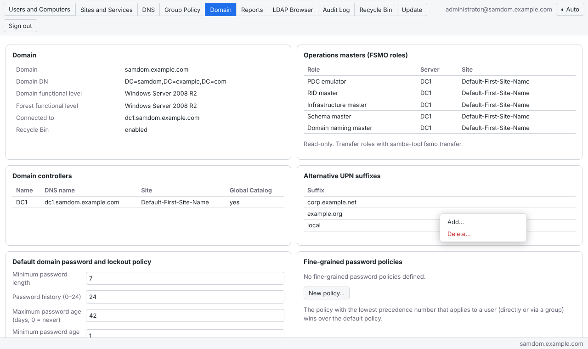

### Reports

Inactive users and computers, expiring passwords, locked and disabled accounts, never-expire passwords, Kerberos
pre-auth disabled, unconstrained delegation, privileged group members and empty groups. All of them export to CSV.
There's also a **bulk CSV user import** that generates passwords for you.

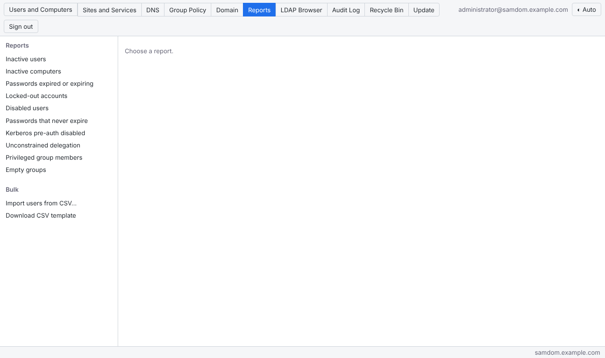

### Audit Log

Every change made through the tool, with passwords redacted. Pass `-audit-log FILE` if you want a permanent
JSON-lines copy as well.

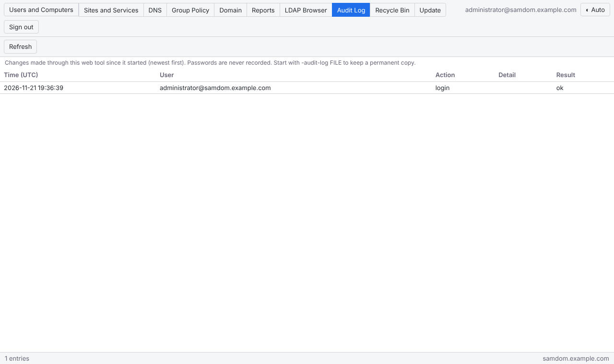

### Recycle Bin

This one needs a bit of explaining. The AD Recycle Bin is an optional feature that is **off by default**, on Windows
too and on a fresh Samba domain. Until it's on, a deleted object is just a tombstone that has lost most of its
attributes and its group memberships. When it's off the page shows an *Enable Recycle Bin…* button. Be careful with
that one: enabling is forest-wide and **can't be undone**. It needs forest functional level 2008 R2 or higher
(`samba-tool domain level raise --forest-level=2008_R2`) and an Enterprise Admins account. It also only helps for
objects deleted *after* it's on. Anything already deleted stays a tombstone.

The page lists the domain's Deleted Objects and the Configuration partition's too, which is where deleted subnets,
sites and site links end up.

DNS records are a special case. A record is only a value on its DNS node, so the AD Recycle Bin never keeps one.
goaduc keeps its own copy instead: records deleted on the DNS page go into `dns-recycle.json` in the data directory
(newest 2000) and show up on this page as *DNS record*. *Restore…* puts the record back as a static record, using the
DNS page's normal rules. Removing or emptying them is limited to Domain and Enterprise Admins. Records deleted by
other tools won't be in there.

Right-click an object for *Restore…*, *Delete…* (remove it for good) or *Empty Recycle Bin…* (remove everything).
*Delete…* on the DNS or Users pages is an ordinary LDAP delete, so the DC only moves the object to the Recycle Bin
while the feature is on. The delete dialog tells you which of the two will happen.

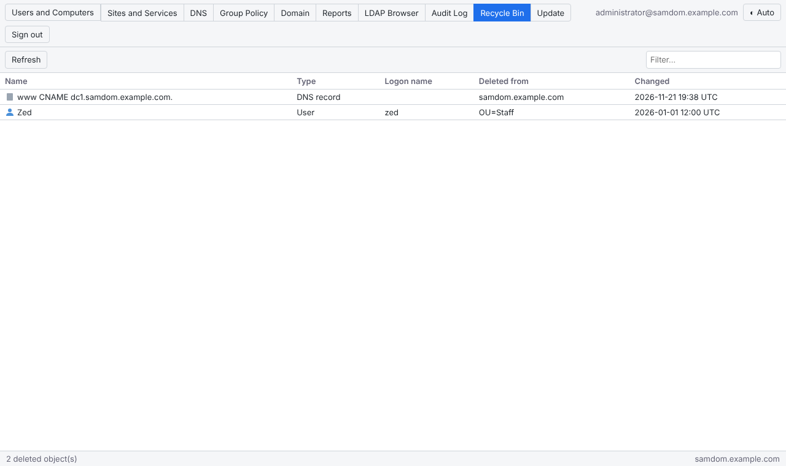

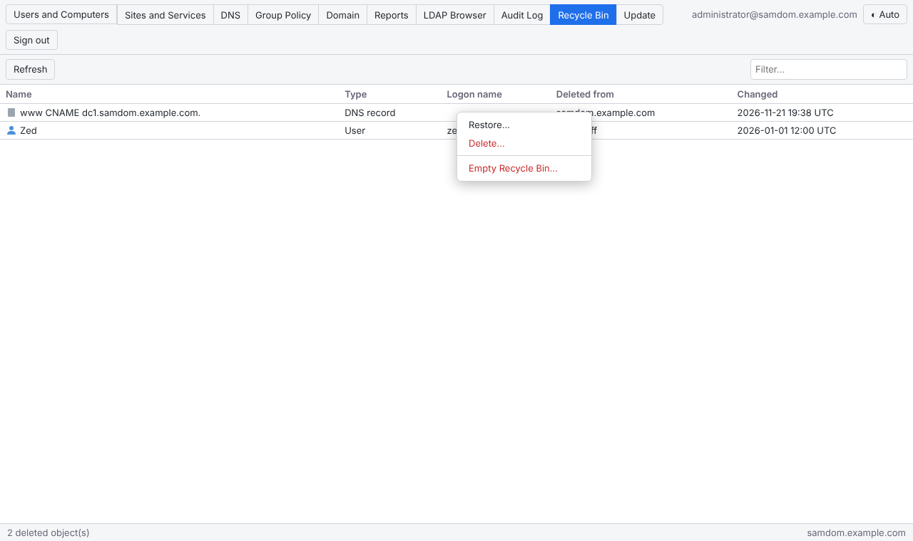

Purging deleted objects is an LDAP delete run as the signed-in user, and a DC may refuse it (real AD does; Samba does).
If that happens and goaduc is running as root with `-sam-db` present, a Domain or Enterprise Admin gets a dialog instead
of an error. Confirming it removes the object from this DC's own database, with `ldbdel` for *Delete…* and
`samba-tool domain tombstones expunge --tombstone-lifetime=0` for *Empty Recycle Bin…*, and both are logged. If any of
that isn't possible you just see the refusal.

**That removal is local and nothing replicates it**, which is why two DCs can end up with different bins. So the same
dialog lists the other domain controllers and can do it on all of them in one go:

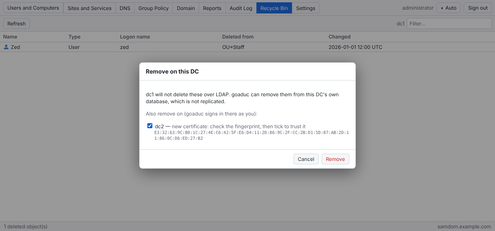

For that, goaduc has to be running on those DCs too (same port as this one, as root with their own `sam.ldb`). It reads
the DC list from the directory, signs in on each other goaduc **as you, with your password**, and repeats the purge there;
that goaduc checks your rights itself. A DC without goaduc shows as not reachable and is skipped, and you'd run
`samba-tool domain tombstones expunge --tombstone-lifetime=0` on it by hand. The page header shows which DC the list
comes from.

Because your password is sent, a peer is only used if its certificate is trusted. A certificate that verifies for the
DC's name (a real CA, or your own CA in the system store) is trusted automatically. A self-signed one is shown as *new*
with its SHA-256 fingerprint: compare it with the one on that DC's Settings → Certificate page, and tick the box to
trust it. goaduc then remembers the fingerprint (`peers.json` in the data directory), and if that DC ever presents a
different certificate it shows *changed* and is not used until you approve it again. Nothing is sent to a peer whose
certificate doesn't match.

Enabling the Recycle Bin has a similar story. Samba refuses that request over LDAP even for Enterprise Admins,
because it only accepts it from its own local system context. So when goaduc runs as root on the DC and gets that
refusal for a verified Enterprise Admin, it applies the same change locally with `ldbmodify` on `-sam-db`
(`ADUC_SAMDB`, default `/var/lib/samba/private/sam.ldb`; needs the `ldb-tools` package). That, SYSVOL writes and the
purge fallback above are the only places goaduc acts with more than the signed-in user's rights.

### Settings

The last tab. It holds two things: the web certificate and the updater.

#### Certificate

By default goaduc serves a self-signed certificate it generated itself, which is why your browser warns you the first
time. To use your own, open **Settings → Certificate**, click *Upload certificate…* and pick the certificate file (PEM,
include the intermediate chain if you have one) and the private key (PEM, no passphrase). If both are in one PEM file,
choose it for the certificate and leave the key empty. goaduc checks that the key matches, that the certificate is
valid right now and has at least one DNS or IP name, then swaps it in on the spot. There is no restart: new connections
get the new certificate, and your open page carries on. The page shows the subject, names, expiry and SHA-256
fingerprint, and *Use self-signed* goes back to the generated one.

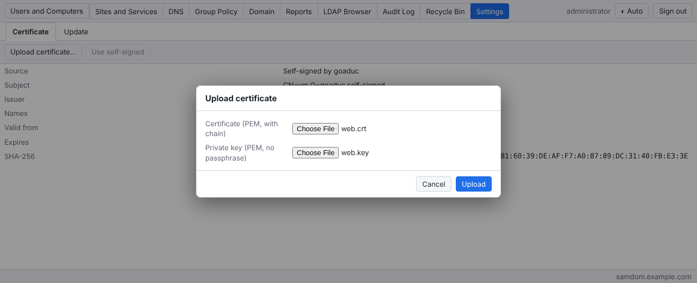

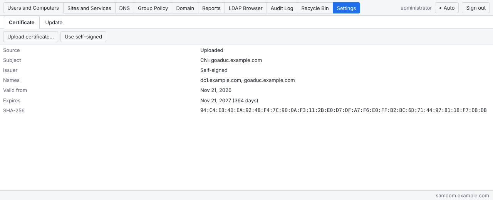

Uploads are kept as `custom.crt` and `custom.key` next to the self-signed pair in the `tls` folder of the data
directory (`/var/lib/goaduc/tls` as root) and are used again after a restart. If they ever stop loading, goaduc falls
back to the self-signed pair instead of refusing to start. Only **Domain Admins and Enterprise Admins** can change the
certificate, and the audit log records who did it (never the key). If you start goaduc with `-tls-cert` and
`-tls-key` (or `ADUC_TLS_CERT` / `ADUC_TLS_KEY`), those files are yours: the page just shows them and you replace the
files and restart. With `-http` there is no certificate at all.

#### Update

You can update goaduc from the web UI. *Check online* looks up the newest release of `-update-repo` on GitHub and
*Update to vN* installs it. *Upload release…* installs a `goaduc_vN.tgz` you already have.

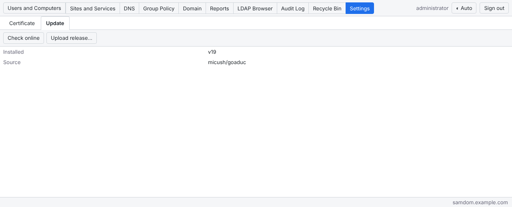

What actually happens: the release is unpacked (links, `..` paths and oversized archives are refused), built on this
host with the Go toolchain the installer keeps in `/usr/local/share/goaduc/go` (or any `go` on `PATH`; cgo off, no
network, no other toolchain downloads), checked with `--version`, and swapped in. Then goaduc re-executes itself, so
the service keeps its PID and everyone has to sign in again.

A few safety rails:

* Only a newer version is accepted. To downgrade, use `install.sh --force`.
* The old binary is kept as `goaduc.prev` (the installer's file). If the new version fails to start three times in a
  row, or doesn't stay up for 60 seconds, it's put back automatically.
* Only **Domain Admins and Enterprise Admins** can update. The service usually runs as root, so this is code
  execution as root.
* `-no-update` turns the page off.

It needs a writable program directory and a Go toolchain, so don't install with `--no-keep-go` if you want this. State
lives in `update/state.json` in the data directory.

## Install (systemd service)

    sudo ./install.sh --server ldaps://dc1.example.com:636
    # then open https://<this host>:8443

If you don't have a copy of the tree, this grabs the newest tagged release from GitHub. Everything after `--` goes to
`install.sh`, and `--version vN` picks a specific tag:

    curl -fsSL https://raw.githubusercontent.com/micush/goaduc/HEAD/get.sh | sudo bash -s -- --server ldaps://dc1.example.com:636

The installer builds from the tree (Go 1.24 or newer, found on the machine or downloaded with checksum verification;
no other dependencies and no C compiler). It creates a `goaduc` service user (only when the service isn't running as
root), installs `/usr/local/sbin/goaduc`, writes `/etc/goaduc/goaduc.conf` (a systemd EnvironmentFile) and a plain
`goaduc.service`, and starts it.

On a Samba DC, where it finds SYSVOL, the service **runs as root**, since editing Group Policy writes SYSVOL.
Anywhere else it runs as the unprivileged `goaduc` user. You can override that with `--run-as root|service|auto` and
`--sysvol DIR`. On a Samba DC the CA at `/var/lib/samba/private/tls/ca.pem` is picked up automatically; otherwise pass
`--ca FILE`.

Running the installer again upgrades in place. Your config and certificate are kept, the previous binary is saved, and
it rolls back by itself if the new version won't start. `--force` reinstalls.

Supported: Ubuntu, Debian, Fedora, RHEL/Rocky/Alma and Arch/Manjaro.

Other options: `--listen`, `--starttls`, `--insecure-ldap`, `--no-start`, `--skip-deps`, `--go PATH`, `--no-keep-go`,
`-y`, `--dry-run`, `--help`.

To remove it, run `sudo goaduc-uninstall`. Add `--purge` to also delete the config, certificate and service user.

## Build and run by hand

    cd source
    go build -o goaduc .
    ./goaduc -server ldaps://dc1.example.com:636 -ca /var/lib/samba/private/tls/ca.pem
    # then open https://localhost:8443 and sign in as administrator@example.com

The web UI is **HTTPS by default**. On first start goaduc generates a self-signed ECDSA certificate (SANs: hostname,
localhost, loopback and local interface addresses; valid about 2 years; regenerated automatically within 30 days of
expiry) in the data directory (`/var/lib/goaduc/tls` as root, otherwise your user config dir). It logs the SHA-256
fingerprint so you can check it against the browser's warning page. To use your own certificate, upload it under Settings →
Certificate, or pass `-tls-cert` and `-tls-key`. Plain HTTP is opt-in with `-http` (default 127.0.0.1:8080), and it warns you if you bind it
to a non-loopback address.

Flags and their environment variables:

* `-listen` (`ADUC_LISTEN`, default `:8443`)
* `-server` (`ADUC_SERVER`)
* `-starttls`
* `-insecure` – turns LDAP certificate verification off; please avoid
* `-ca`
* `-data-dir` (`ADUC_DATA_DIR`)
* `-tls-cert` / `-tls-key` (`ADUC_TLS_CERT` / `ADUC_TLS_KEY`)
* `-http` (`ADUC_HTTP=1`)
* `-sysvol` (`ADUC_SYSVOL`)
* `-sam-db` (`ADUC_SAMDB`)
* `-audit-log` (`ADUC_AUDIT_LOG`)
* `-update-repo` (`ADUC_UPDATE_REPO`, default `micush/goaduc`)
* `-no-update` (`ADUC_NO_UPDATE=1`)
* `-version`

## Themes

The UI follows your system's light or dark setting. The button in the top bar (and on the sign-in page) cycles through
Auto, Light and Dark, and your choice is remembered in the browser.

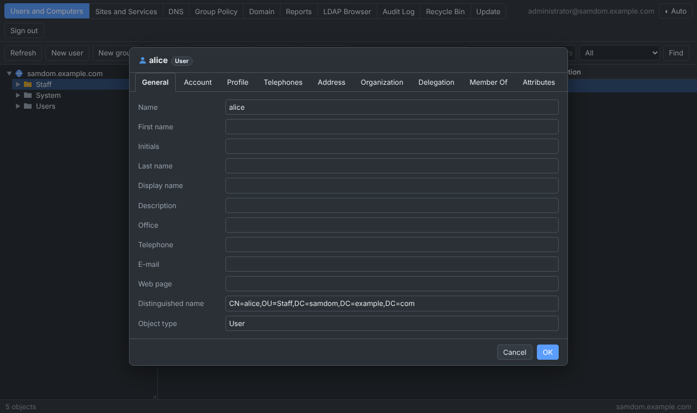

## Things worth knowing

* **Signing in:** use `administrator@example.com` (UPN), `EXAMPLE\administrator`, a full DN, or just your logon name
  (`administrator`, the sAMAccountName). A bare name is sent to the server as typed first; if the server refuses it,
  goaduc reads the domain name from the DC's RootDSE and tries `name@domain` once more. Anyone whose UPN uses another
  suffix can type that UPN as usual.
* Setting or resetting a password needs an encrypted LDAP connection (ldaps:// or `-starttls`). Samba refuses
  `unicodePwd` otherwise.
* Every operation runs as the signed-in user, so AD delegation and ACLs apply. Credentials are held in server memory
  only, with a 30 minute idle timeout. If it isn't on localhost, put it behind HTTPS.
* Samba's `ldap server require strong auth` default is fine with LDAPS and StartTLS simple binds.
* Saved queries live in the browser's local storage, so they're per browser and not shared.
* The Go code, `go.mod`, `VERSION` and the web UI files all live in `source/`, so run `go build`, `go test` and the mock
  from there.
* `go test` covers the BER, filter and client code against an in-process mock server. I exercised the full UI against a
  mock directory, **not a real Samba DC**, so please try it on a test domain first.
* To click around without a DC, run `ADUC_MOCK_SERVE=1 go test -run TestMockServe -timeout 0`. It serves the mock
  directory on 127.0.0.1:3389 and the UI on 127.0.0.1:8099. Any user name and password will do. The screenshots in
  `snaps/` were taken this way.

## License and history

Free software under the GNU GPL v3 (see `LICENSE`). The history is in `CHANGELOG.md`, and the rules for contributors
and maintainers are in `CLAUDE.md`. Pure Go standard library, no third-party modules, no cgo. Linux is the supported
platform for the installer.
